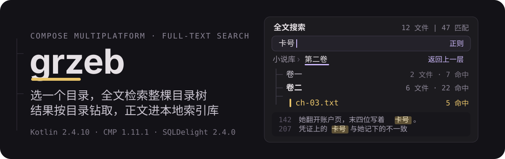
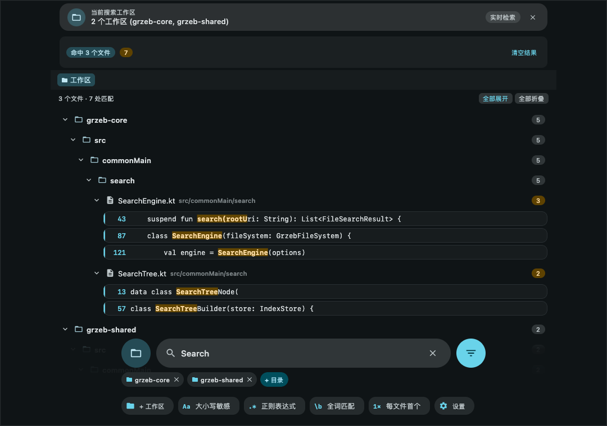
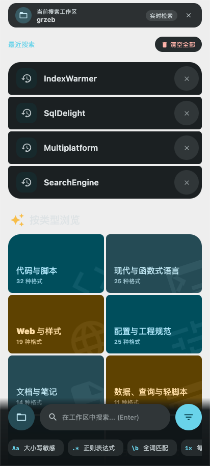
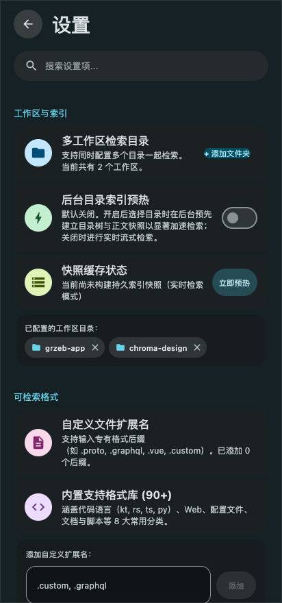
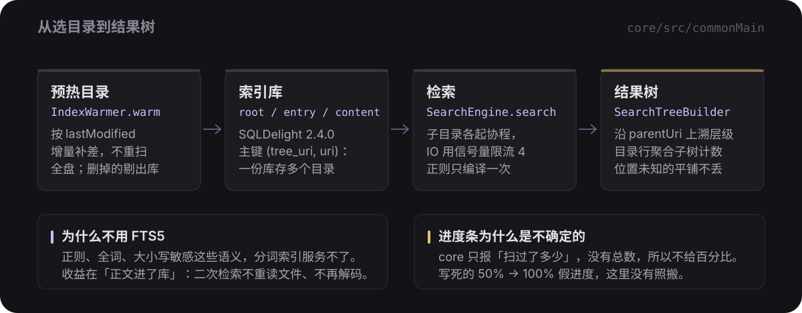

# grzeb

<p align="center">
  
</p>

<p align="center">
  <a href="https://github.com/HibernalGlow/grzeb/releases/latest"></a>
  <a href="https://kotlinlang.org"></a>
  <a href="https://www.jetbrains.com/compose-multiplatform/"></a>
  <a href="https://sqldelight.github.io/sqldelight/"></a>
  <a href="./LICENSE"></a>
</p>

<p align="center">简体中文 · <a href="./README_EN.md">English</a></p>

**grzeb** 是一款基于 **Compose Multiplatform** 构建的高性能跨平台本地代码与纯文本检索工具，深度覆盖 **桌面端（macOS / Windows / Linux）** 与 **移动端（Android）**。

界面设计遵循最新的 **Material 3 Expressive（M3E）** 规范，并结合类似 **VSCode** 的层级检索与多工作区组织体验。告别单薄的扁平结果流，按真实目录树分层聚合，支持多目录并行检索、增量秒级预热、最近搜索历史与自定义后缀过滤。

---

### 📥 快速下载安装

最新正式发布版本：**[v0.2.2](https://github.com/HibernalGlow/grzeb/releases/tag/v0.2.2)**

| 平台 | 安装包产物 | 说明 |
| :--- | :--- | :--- |
| 🍎 **macOS** | [`grzeb-0.2.2-macos.dmg`](https://github.com/HibernalGlow/grzeb/releases/download/v0.2.2/grzeb-0.2.2-macos.dmg) | 原生 DMG 镜像（首次运行在「系统设置 → 隐私与安全性」放行即可） |
| 🪟 **Windows** | [`grzeb-0.2.2-windows.msi`](https://github.com/HibernalGlow/grzeb/releases/download/v0.2.2/grzeb-0.2.2-windows.msi) | 原生 MSI 安装程序引导 |
| 🐧 **Linux** | [`grzeb-0.2.2-linux.deb`](https://github.com/HibernalGlow/grzeb/releases/download/v0.2.2/grzeb-0.2.2-linux.deb) | Debian / Ubuntu 软件包 |
| 📱 **Android** | [`grzeb-0.2.2-android-debug.apk`](https://github.com/HibernalGlow/grzeb/releases/download/v0.2.2/grzeb-0.2.2-android-debug.apk) / [`*-release.apk`](https://github.com/HibernalGlow/grzeb/releases/download/v0.2.2/grzeb-0.2.2-android-release.apk) | 支持 Android 7.0+（API 24~36，已签名可直接安装测试） |

---

## 🌟 核心特性一览

### 1. VSCode 风格层级结果树与多工作区支持
- **多目录聚合检索**：支持同时添加多个工作区目录并行检索，树根按 Workspace 清晰分离。
- **相对路径真实分层**：无论底层是本地文件路径还是 Android SAF URI，均统一基于从根算起的相对路径还原树结构。
- **就地折叠与批量控制**：支持整行就地展开/折叠目录，提供快捷「全部展开」与「全部折叠」动作；文件节点副标题清晰展示所属相对路径与匹配命中徽章。

<p align="center">
  
</p>

### 2. Material 3 Expressive 设计规范
- **Rhythm 风格视觉质感**：顶部 36dp 主容器品牌徽章、全景底部搜索栏、自适应动态弹性圆角与光标反馈。
- **展开式筛选胶囊**：底部栏集成「区分大小写」、「正则表达式」、「全词匹配」以及「仅预热」即时筛选。
- **表现力空状态**：集成常见格式分类矩阵（代码、网页、文本、配置、文档）与最近搜索历史记录，支持一键点击回填、单项清理与全量清空。

<p align="center">
  
</p>

### 3. Rhythm 风格分组设置面板
- **四段式结构化管理**：工作区管理、索引预热开关、检索格式拓展、搜索偏好设置。
- **预热开关与动态波浪指示器**：支持按需关闭预热仅走实时文件系统，或开启预热享受 `LinearWavyProgressIndicator` 动态索引反馈。
- **格式库与用户自定义后缀**：直观展示 50+ 种在册分类扩展名，并允许用户自由输入添加/删除自定义扩展名（如 `.custom`、`.vue`、`.proto`）。
- **实时过滤**：设置顶部配备过滤搜索栏，支持关键词即时筛选各分组内容。

<p align="center">
  
</p>

---

## ⚙️ 核心架构与原理

<p align="center">
  
</p>

- **正文缓存，不用 FTS5**：检索需精准支持任意正文字符串、正则、全词匹配与大小写敏感，分词全文索引无法满足代码与非切词文本需求。通过将正文缓存入 SQLite，二次检索直接在内存中极速流式匹配。
- **高并发协程遍历**：子目录独立协程，同目录下按批次并发读取，借助 `Semaphore(concurrency)` 严格控制 IO 压力。特别是在 Android SAF 跨进程调用的场景下，并发收益显著。
- **读穿缓存（Read-Through）**：`IndexedFileSystem` 优先查缓存快照，未完成时无感回落至真实文件系统；预热完成后自动复查时间戳保持同步。
- **增量同步**：依据 `lastModified` 比对磁盘文件，磁盘已删除文件自动从库中剔除。

### 中文不乱码是硬要求

判定顺序实现于 `core/src/commonMain/kotlin/dev/hibernalglow/grzeb/core/text/TextDecoder.kt`：

```text
1. BOM 优先：UTF-8 / UTF-16 LE / UTF-16 BE
2. 含 NUL 字节 → 隔字节 NUL 判定为无 BOM UTF-16；否则判为二进制（jpg/apk/zip 在此步拦截）
3. 按 UTF-8 解码，若无替换字符直接采纳
4. 回落 GB18030（兼容 GBK / GB2312）：
   - 解码不得出现替换字符
   - 且汉字字符占比 ≥ 5%（避免误判 Latin-1）
5. 替换字符比例超过全文 1/10 时回退 Latin-1 逐字节映射；否则保留带标记的 UTF-8 文本
```

---

## 🖥️ 平台支持矩阵

| 平台能力 | 桌面端 (JVM: macOS / Windows / Linux) | 移动端 (Android) |
| :--- | :--- | :--- |
| **目录选择** | macOS 原生 `FileDialog` / 其他系统 Swing `JFileChooser` | Android SAF（Storage Access Framework）Tree URI |
| **索引库存储** | 本地目录持久化 `~/.grzeb/index.db` | 应用沙盒内 `grzeb-index.db` |
| **真实全文检索** | 支持（多工作区并行、内存高速缓存） | 支持（SAF 树增量并发读） |
| **在文件管理器中定位** | 原生支持（macOS `open -R` / Win `explorer /select,` / Linux `xdg-open`） | 移动端无此概念（点击直接在内置预览器查看命中行） |
| **M3 自适应布局** | 双栏分栏，支持拖拽调节宽度并自动记忆 | 单栏折叠视图，根据窗口尺寸自动切流 |
| **系统返回** | 无系统级返回手势（用关闭按钮） | 预测性返回手势收起预览：手势中预览跟着手指滑出，提前看到退回的结果列表（Android 13+ 支持，Android 15+ 默认启用） |

---

## 🛠️ 本地开发与构建

### 开发环境要求
- **JDK 17+**（构建脚本已适配 JDK 21）
- **Android SDK**（编译 target 需 Android 37 预览通道或对应 AGP 9.1+ 环境）

### 常用 Gradle 指令
```bash
# 启动桌面端调试
./gradlew :desktopApp:run

# 编译并安装 Android 调试包（需连接真机或启动模拟器）
./gradlew :androidApp:installDebug

# 运行跨平台核心单元测试
./gradlew test :core:jvmTest :shared:jvmTest

# 打包当前操作系统的原生桌面安装包（DMG / MSI / DEB）
./gradlew :desktopApp:packageDistributionForCurrentOS
```

### 模块结构
```text
core/        平台无关的核心逻辑：文件系统抽象、解码、SQLDelight 索引库、检索引擎、树构建器（零 UI 依赖）
shared/      共用 Compose UI 界面、M3 Expressive 组件库与 PlatformServices 平台服务
desktopApp/  桌面端入口（macOS/Win/Linux 窗口生命周期、AWT 适配）
androidApp/  移动端入口（Android Activity、SAF 授权与权限生命周期）
```

---

## 📌 当前已知边界与规划

- **iOS 目标**：架构上已实现平台解耦，待接入 Kotlin/Native 工具链与 iOS DocumentPicker。
- **电子书正文提取**：`.epub` / `.mobi` 扩展名在预设中，但当前仅作纯文本解压探测，暂未接入完整的流式正文解析器。
- **授权许可**：本项目基于 [MIT License](./LICENSE) 开源。
